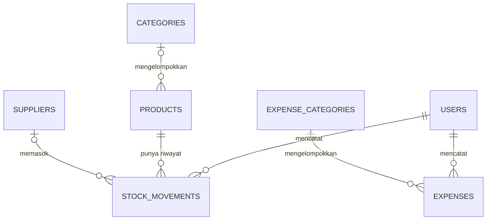

# PRD: Dashboard Barang Masuk, Barang Keluar, dan Pengeluaran
Status: **DRAF v0.1**, untuk didiskusikan

## 1. Latar belakang
Usaha kecil sering mencatat stok dan pengeluaran di buku atau file terpisah. Akibatnya stok tidak
cocok dengan fisik, dan pemilik tidak tahu ke mana uang keluar setiap bulan.

## 2. Tujuan
- Stok terkini setiap barang terlihat dalam satu layar.
- Total pengeluaran (pembelian barang + operasional) terlihat per hari dan per bulan.
- Setiap catatan bisa ditelusuri: siapa, kapan, berapa.

## 3. Pengguna
| Peran | Kebutuhan |
|---|---|
| Pemilik | Melihat dasbor, laporan, dan mengelola akun staf |
| Staf | Mencatat barang masuk, barang keluar, dan pengeluaran |

## 4. Ruang lingkup MVP
| # | Fitur | Keterangan |
|---|---|---|
| F1 | Login & peran | Pemilik dan staf |
| F2 | Master barang | Kode, nama, kategori, satuan, harga beli, stok minimum |
| F3 | Barang masuk | Tanggal, jumlah, harga beli per satuan, pemasok |
| F4 | Barang keluar | Tanggal, jumlah, alasan (terjual, rusak, retur) |
| F5 | Pengeluaran operasional | Tanggal, kategori (listrik, gaji, transport, dll.), nominal, catatan |
| F6 | Dasbor | Stok menipis, grafik masuk vs keluar, pengeluaran bulan ini per kategori |
| F7 | Laporan | Filter tanggal dan ekspor CSV |

**Di luar lingkup:** kasir/POS, multi-cabang, barcode, akuntansi dan laba rugi.

## 5. Aturan bisnis
- Stok hanya berubah lewat catatan barang masuk/keluar.
- Barang keluar ditolak jika stok tidak cukup.
- Pengeluaran total = nilai barang masuk (jumlah x harga beli) + pengeluaran operasional.
  Pembelian barang **tidak** dicatat lagi di pengeluaran operasional, supaya tidak terhitung dua kali.
- Uang disimpan sebagai bilangan bulat rupiah.

## 6. Kebutuhan non-fungsional
Responsif di HP, password di-hash, dasbor terbuka kurang dari 2 detik.

## 7. Relasi antar tabel (ERD)
Skema lengkap ada di `db/schema.sql`.

## 8. Metrik keberhasilan
- Mencatat satu transaksi kurang dari 30 detik.
- Selisih stok sistem vs fisik di bawah 2%.

## 9. Pertanyaan untuk diskusi
1. Jenis usaha yang jadi target?
2. Perlu mencatat pemasukan penjualan juga, atau cukup pengeluaran?
3. Satu toko saja, atau banyak toko?
